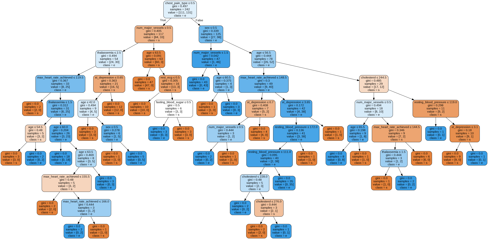

# Heart Disease Prediction

<p align="center">

  
  
  
  

</p>

<p align="center">

  
  
  
  
  

</p>

> A machine learning project that compares five classification algorithms for predicting the presence of heart disease from clinical patient data.

---

## Overview

Heart disease is one of the most important areas where data-driven analysis can assist researchers and healthcare professionals.

This project explores how supervised machine learning algorithms can be applied to a heart disease dataset to identify patterns associated with the presence of cardiovascular disease.

The project compares **five different machine learning algorithms**:

* Logistic Regression
* Random Forest
* Naive Bayes
* K-Nearest Neighbors (KNN)
* Decision Tree

The models are trained, evaluated, and compared, with additional experimentation performed to improve model performance.

> **Important:** This project is intended for educational and research purposes only. It is not a medical diagnostic system and should not be used as a substitute for professional medical advice.

---

## What This Project Does

The overall workflow is:

```text
             ┌─────────────────────┐
             │   Heart Disease     │
             │       Dataset       │
             └──────────┬──────────┘
                        │
                        ▼
             ┌─────────────────────┐
             │ Data Preprocessing  │
             │ & Exploration       │
             └──────────┬──────────┘
                        │
                        ▼
             ┌─────────────────────┐
             │ Feature Analysis    │
             └──────────┬──────────┘
                        │
                        ▼
       ┌────────────────┼────────────────┐
       │                │                │
       ▼                ▼                ▼
 Logistic           Random           Naive
 Regression         Forest           Bayes
       │                │                │
       └────────────────┼────────────────┘
                        │
             ┌──────────┴──────────┐
             │                     │
             ▼                     ▼
           KNN              Decision Tree
             │                     │
             └──────────┬──────────┘
                        ▼
             ┌─────────────────────┐
             │ Model Evaluation    │
             │ & Comparison        │
             └─────────────────────┘
```

---

## Machine Learning Models

### 1. Logistic Regression

A linear classification algorithm used as one of the baseline models.

It estimates the probability of the target belonging to a particular class and is commonly used for binary classification problems.

### 2. Random Forest

An ensemble learning algorithm that combines multiple decision trees to produce a more robust prediction.

Random Forest can capture nonlinear relationships between features and the target variable.

### 3. Naive Bayes

A probabilistic classification algorithm based on Bayes' theorem.

It assumes conditional independence between features and provides a simple and efficient classification approach.

### 4. K-Nearest Neighbors

KNN predicts the class of a data point based on the classes of its nearest neighbors.

The algorithm is intuitive and useful for understanding distance-based classification.

### 5. Decision Tree

A tree-based classification algorithm that makes predictions by recursively splitting the dataset based on feature values.

The project also explores adjustments to the algorithm to improve predictive performance.

---

## Dataset

The project uses the **Heart Disease dataset**, based on the Cleveland heart disease database.

The dataset contains clinical attributes associated with patients and a target representing the presence or absence of heart disease.

The commonly used subset contains **14 attributes**, including:

| Feature    | Description                       |
| ---------- | --------------------------------- |
| `age`      | Age of the patient                |
| `sex`      | Sex                               |
| `cp`       | Chest pain type                   |
| `trestbps` | Resting blood pressure            |
| `chol`     | Serum cholesterol                 |
| `fbs`      | Fasting blood sugar               |
| `restecg`  | Resting ECG results               |
| `thalach`  | Maximum heart rate achieved       |
| `exang`    | Exercise-induced angina           |
| `oldpeak`  | ST depression induced by exercise |
| `slope`    | Slope of peak exercise ST segment |
| `ca`       | Number of major vessels           |
| `thal`     | Thalassemia result                |
| `target`   | Heart disease presence            |

The original dataset is associated with researchers and institutions including the Hungarian Institute of Cardiology, University Hospital Zurich, University Hospital Basel, and the V.A. Medical Center / Cleveland Clinic Foundation.

---

## Project Structure

```text
Heart_disease_prediction/
│
├── .github/
│   └── ISSUE_TEMPLATE/
│
├── HeartDisease.ipynb
├── heart_Disease.ipynb
├── hd.ipynb
├── hd2.ipynb
│
├── heart.csv
├── processed_heart_data.csv
│
├── final.png
├── pred.jpg
├── download.png
├── Large45.jpg
│
├── PPT.pptx
├── Project Report Softcopy.pdf
│
├── CODE_OF_CONDUCT.md
├── LICENSE
└── README.md
```

### Important files

| File                          | Purpose                                   |
| ----------------------------- | ----------------------------------------- |
| `heart.csv`                   | Original heart disease dataset            |
| `processed_heart_data.csv`    | Processed dataset                         |
| `HeartDisease.ipynb`          | Non Main notebook                         |
| `heart_Disease.ipynb`         | Main Notebook                             |
| `hd.ipynb`                    | Supporting notebook                       |
| `hd2.ipynb`                   | Supporting notebook                       |
| `Project Report Softcopy.pdf` | Detailed project report                   |
| `PPT.pptx`                    | Project presentation                      |
| `final.png`                   | Project output/visualization              |
| `pred.jpg`                    | Prediction output                         |
| `LICENSE`                     | MIT License                               |

---

## Getting Started

### Prerequisites

You'll need:

* Python 3.x
* Jupyter Notebook or JupyterLab
* Git

### Clone the repository

```bash
git clone https://github.com/chayandatta/Heart_disease_prediction.git

cd Heart_disease_prediction
```

### Install dependencies

If you are using a local Python environment, install the required machine learning/data analysis libraries:

```bash
pip install numpy pandas matplotlib seaborn scikit-learn jupyter
```

### Start Jupyter Notebook

```bash
jupyter notebook
```

Open:

```text
heart_Disease.ipynb
```

and run the notebook cells sequentially.

---

## Machine Learning Workflow

The project follows a standard supervised machine learning workflow:

### 1. Data Collection

Load the heart disease dataset from `heart.csv`.

### 2. Data Exploration

Explore:

* Dataset dimensions
* Feature distributions
* Target distribution
* Statistical properties
* Relationships between variables

### 3. Data Preprocessing

Prepare the dataset for machine learning by processing the relevant features and target values.

### 4. Model Training

Train multiple classification algorithms:

```text
Logistic Regression
        ↓
Random Forest
        ↓
Naive Bayes
        ↓
KNN
        ↓
Decision Tree
```

### 5. Model Evaluation

Compare the models using classification performance metrics and identify promising approaches.

### 6. Model Improvement

The project experiments with different aspects of the algorithms to improve predictive accuracy.

---

## Model Comparison

The main objective of the project is not simply to train one model, but to understand how different classification algorithms perform on the same dataset.

| Model               | Type                     |
| ------------------- | ------------------------ |
| Logistic Regression | Linear classifier        |
| Random Forest       | Ensemble / tree-based    |
| Naive Bayes         | Probabilistic classifier |
| KNN                 | Distance-based           |
| Decision Tree       | Tree-based               |

This comparison provides a useful introduction to the strengths and weaknesses of different supervised learning approaches.

---

## Results

The notebooks contain the experiments and model evaluation performed during the project.

The project ultimately explores improvements to the classification models, including experimentation with the Decision Tree approach.

For the exact experimental results, metrics, and visualizations, see:

* [`heart_Disease.ipynb`](https://github.com/chayandatta/Heart_disease_prediction/blob/master/heart_Disease.ipynb)
* [`Project Report Softcopy.pdf`](https://github.com/chayandatta/Heart_disease_prediction/blob/master/Project%20Report%20Softcopy.pdf)

---

## Example Output

The repository includes visual outputs generated during the project.

<p align="center">
  
</p>

---

## Technologies

The project primarily uses the Python data science and machine learning ecosystem.

| Technology       | Purpose                           |
| ---------------- | --------------------------------- |
| Python           | Programming language              |
| Jupyter Notebook | Interactive experimentation       |
| Pandas           | Data manipulation                 |
| NumPy            | Numerical computation             |
| Matplotlib       | Data visualization                |
| Seaborn          | Statistical visualization         |
| Scikit-learn     | Machine learning                  |
| GitHub           | Version control and collaboration |

---

## Why This Project?

This project was built to explore the practical application of machine learning to a real-world classification problem.

It demonstrates several important ML concepts:

* Supervised learning
* Binary classification
* Data preprocessing
* Exploratory data analysis
* Feature analysis
* Model training
* Model comparison
* Model evaluation
* Hyperparameter experimentation
* Data visualization

It is also designed to be approachable for people learning the fundamentals of machine learning.

---

## Project Resources

### Notebook

[Explore the main Jupyter Notebook](https://github.com/chayandatta/Heart_disease_prediction/blob/master/heart_Disease.ipynb

### Project Report

[Read the full project report](https://github.com/chayandatta/Heart_disease_prediction/blob/master/Project%20Report%20Softcopy.pdf)

### Presentation

[View the project presentation](https://github.com/chayandatta/Heart_disease_prediction/blob/master/PPT.pptx)

### Dataset

[View `heart.csv`](https://github.com/chayandatta/Heart_disease_prediction/blob/master/heart.csv)

---


## Contributing

Contributions are welcome.

If you'd like to improve the project:

1. Fork the repository.
2. Create a feature branch.

```bash
git checkout -b feature/improvement
```

3. Make your changes.
4. Commit your changes.

```bash
git commit -m "Improve model evaluation"
```

5. Push the branch.

```bash
git push origin feature/improvement
```

6. Open a Pull Request.

Ideas for future contributions include:

* Additional classification algorithms
* Better feature engineering
* Cross-validation
* Hyperparameter optimization
* ROC-AUC analysis
* Precision/recall analysis
* Explainable AI
* Model deployment
* Interactive prediction interface

---

## Limitations

This project has several important limitations:

* The dataset is relatively small.
* The models are trained for educational experimentation rather than clinical deployment.
* Model performance on this dataset does not imply real-world medical effectiveness.
* Predictions should not be interpreted as medical diagnoses.
* Additional validation using larger and more representative datasets would be required for any real-world application.

---

## Future Improvements

Potential next steps include:

```text
Current Project
      │
      ├── Multiple ML Models
      ├── Data Exploration
      ├── Model Comparison
      └── Prediction
              │
              ▼
       Future Improvements
              │
              ├── Hyperparameter Optimization
              ├── Cross Validation
              ├── Feature Selection
              ├── Explainable AI
              ├── Model Serialization
              ├── REST API
              └── Web Application
```

A future version could expose the trained model through a REST API and provide an interactive interface for experimentation.

---

## License

This project is licensed under the **MIT License**.

See [`LICENSE`](./LICENSE) for more information.

---

## Disclaimer

This repository is intended **solely for educational and research purposes**.

The machine learning models presented here are experimental and should **not** be used to diagnose, treat, or make medical decisions about any individual.

Always consult a qualified healthcare professional for medical advice.

---

## Author

### Chayan Datta

Software Engineer | Python | Backend | AI | Machine Learning

GitHub: [@chayandatta](https://github.com/chayandatta)

---

<p align="center">
  <b>If you found this project useful, consider giving it a ⭐</b>
</p>

<p align="center">
  Made with Python, Jupyter & Machine Learning
</p>
